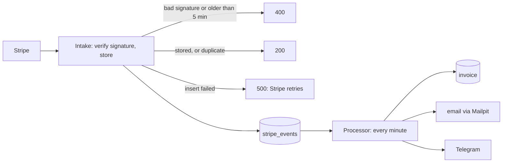
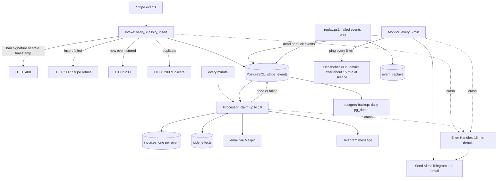

# Stripe payments to invoices with n8n and PostgreSQL

A pipeline of five n8n workflows that turns Stripe payment events into invoices plus email and Telegram notifications. It stores every event before acknowledging it, creates one invoice per paid event, and makes failures visible: dead or stuck events raise alerts, and a failed event can be replayed with an audit trail.

**Stripe sandbox only.** It runs on my machine in Docker, email goes to a local Mailpit inbox, and nothing is live. A real deployment would need the changes in [`docs/live-mode-checklist.md`](docs/live-mode-checklist.md), which I wrote but never executed.

What I can show, each with the output behind it in [`docs/evidence.md`](docs/evidence.md):

- **No double invoice or message.** Resending a Stripe event, or running the Processor again on the same event, leaves exactly 1 invoice, 1 email and 1 Telegram message. [Checked on every e2e run.](docs/evidence.md#duplicate-event-200-duplicate-1-row)
- **No 200 for an event that was not stored.** With Postgres stopped, Intake answered 500 to all 7 events of a Stripe CLI trigger. After the restart a resend stored exactly 1 row and it ended `done`. [Recorded output.](docs/evidence.md#database-down-500-then-the-resend-stores-1-row)
- **Failures reach a human.** Dead and stuck events raise one alert (Telegram and email) and can be replayed with a reason and an audit row; replay never touches invoices. [Recorded.](docs/evidence.md#alerts-and-replay)
- **Silence is detected.** An outside heartbeat emails me after about 15 minutes without a ping, and a Postgres backup restores into a throwaway container with matching row counts. [Recorded.](docs/evidence.md#hardening)
- **42 end-to-end checks** run through one script after every change (by hand; there is no CI): [`scripts/e2e.ps1`](scripts/e2e.ps1).

What I could not prove is listed just as plainly: [known limits](#known-limits) and [not proven](docs/evidence.md#not-proven).

## How it works

1. **Accept and store.** Intake checks the Stripe signature (HMAC-SHA256, constant-time compare) and rejects timestamps older than 5 minutes. It classifies the event and inserts it idempotently: a paid `checkout.session.completed` or an `async_payment_succeeded` becomes `pending`, everything else `ignored`. It answers 200, 200 duplicate, 400, or 500 if the insert failed. The response is sent only after the insert, so Stripe's own retries cover an outage.
2. **Claim atomically.** Every minute the Processor releases rows stuck in `processing` for more than 10 minutes, then claims up to 10 eligible rows (`pending`, or `failed` with fewer than 5 attempts) in one statement with `FOR UPDATE SKIP LOCKED`.
3. **Invoice first.** Each valid paid event gets one invoice before any notification: `event_id` is `UNIQUE`, and `INV-<year>-<6 digits>` comes from a PostgreSQL sequence. Amounts stay in Stripe's smallest unit (JPY 1500 is 1500) and are shown with `Intl.NumberFormat('de-DE')`.
4. **Deliver once per kind.** For `email` and `telegram` the Processor checks `side_effects(event_id, kind)`, sends if there is no row, then inserts one. Telegram gets up to 3 tries (2 s, then 4 s) for 429, 5xx and network errors only. Missing or invalid customer email, amount or currency marks the event `failed` with a clear `last_error`; there is no fallback address.
5. **Watch.** A Monitor workflow looks every 5 minutes for exhausted retries, stale pending, stuck failed and stuck processing events. Crashed workflows go through an Error Handler with a 15-minute throttle per (workflow, node). Both use one shared Send Alert workflow.
6. **Replay.** `scripts/replay.ps1` accepts only `failed` events, resets them in one transaction and writes an `event_replays` row with the reason.

Details and criteria: [M3](PLAN.md#m3-stripe-processor), [M4](PLAN.md#m4-failure-visibility), [M5](PLAN.md#m5-hardening). Operating it: [`docs/runbook.md`](docs/runbook.md).

The full picture, including alerting and recovery

## Engineering decisions

- **Store first, answer 500 if storage fails.** An early 200 would tell Stripe the event arrived and lose it; a 500 makes Stripe retry. [Output](docs/evidence.md#database-down-500-then-the-resend-stores-1-row).
- **Database constraints, not check-then-insert.** `UNIQUE` on the event and on the invoice's event, plus `ON CONFLICT`, hold under concurrency. See [`migrations/`](migrations/).
- **`ON DELETE RESTRICT` on financial records.** A payment event cannot be deleted while its invoice exists. An earlier plan said `CASCADE`; I changed it.
- **Two timestamps with one meaning each.** `pending_since` dates the current pending episode and `claimed_at` dates the processing claim, so a row released after 30 minutes does not look stale. [M4 criteria 4 and 5](PLAN.md#m4-failure-visibility).
- **The Monitor is a separate workflow.** A Processor that has stopped cannot report that it stopped.
- **Alerting also fails safely.** The crash throttle keeps its state in n8n's static data, so it works when Postgres is the thing that is down. The Monitor sets `alerted_at` only after delivery, so an undelivered alert is retried.
- **Every check must be able to fail.** After M5 I made each new check fail on purpose, because three of them could never have failed. Example: the stale-timestamp check has a fresh-timestamp control, and both ways of breaking it were provoked ([how](docs/evidence.md#stale-timestamp-400)).
- **Secrets stay out of the repo and out of output.** Compose holds `${VAR}` references only; scripts read secrets inside WSL and print yes/no. A hook blocks the unsafe `wsl` quoting forms that once printed a secret.

## Failure scenarios and evidence

Labels: **e2e** is asserted on every run of [`scripts/e2e.ps1`](scripts/e2e.ps1); **provoked** means I broke it on purpose and kept the output; **unproven** means designed and coded, never provoked. Full output for each row is in [`docs/evidence.md`](docs/evidence.md).

| Scenario | Behavior | Label |
|---|---|---|
| Fake signature | 400, event not stored | **e2e** ([output](docs/evidence.md#fake-signature-400)) |
| Validly signed, older than 5 min | 400, not stored; a fresh control is accepted | **e2e** ([output](docs/evidence.md#stale-timestamp-400)) |
| Validly signed, dated 1 h in the future | Accepted and stored (the window is one-sided) | **provoked**, a [known limit](#known-limits) ([output](docs/evidence.md#future-timestamp-accepted-a-limit)) |
| Duplicate event | 200 duplicate, 1 row, 1 invoice, 1 email, 1 Telegram message | **e2e** ([output](docs/evidence.md#duplicate-event-200-duplicate-1-row)) |
| Postgres down during Intake | 500 for every event; after restart a resend stores 1 row and it ends `done` | **provoked** ([output](docs/evidence.md#database-down-500-then-the-resend-stores-1-row)) |
| Processor runs again on a done event | Attempts go up, still 1 invoice and 1 message of each kind | **e2e** ([output](docs/evidence.md#re-run-on-the-same-event-no-second-invoice-or-message)) |
| Two claims at once | The second session gets 0 rows (and, without `SKIP LOCKED`, waits and takes them). Two whole workflow runs racing was not reproduced | **provoked**, claim statement only ([output](docs/evidence.md#two-claims-at-once-no-double-claim)) |
| `ignored` events | Never claimed, processed or invoiced (102 rows checked) | **provoked** ([output](docs/evidence.md#ignored-events-untouched)) |
| Mailpit down | Event `failed` with `last_error`; after recovery `done` with 1 email | **provoked** ([output](docs/evidence.md#mailpit-down-failed-then-done-with-1-email)) |
| Telegram answers 429 or 5xx | Retry with backoff is coded (3 tries, 2 s then 4 s) | **unproven**: no real 429 or 5xx was ever provoked |
| Postgres down during Processor runs | One crash alert per (workflow, node) per 15 min, then a suppressed count | **provoked** ([output](docs/evidence.md#postgres-down-one-throttled-crash-alert)) |
| Event reaches 5 failed attempts | One dead-event alert, none after; replay ends `done` with 1 email, 1 invoice, 1 audit row | **provoked** ([output](docs/evidence.md#dead-event-one-alert-replay-ends-done)) |
| Replay of a `done` event or a malformed id | Refused, rows unchanged; the id never reaches psql | **e2e** for `done` and malformed ids; `ignored` and unknown ids **provoked** |
| Stale pending, stuck failed, stuck processing | One alert each, a fresh control gets none, the Processor clears the marker | **provoked** ([output](docs/evidence.md#stuck-rows-stale-pending-stuck-failed-stuck-processing)) |
| One alert channel down | The other still delivers; `alerted_at` is set | **provoked** with Mailpit down ([output](docs/evidence.md#one-alert-channel-down)) |
| Both alert channels down | Monitor should leave `alerted_at` unset and retry | **unproven** |
| n8n, WSL or the PC goes silent | Healthchecks.io emails after about 15 min | **provoked** once; that outage ended in an unplanned reboot ([output](docs/evidence.md#heartbeat)) |
| Wrong Postgres password in the backup config | e2e fails (TCP login from the backup container) | **e2e**, made to fail four ways ([output](docs/evidence.md#backup-and-restore)) |
| Backup restore | Restored into a throwaway container, row counts match live; a mismatch exits 1 | **provoked** ([output](docs/evidence.md#backup-and-restore)) |
| Postgres password rotation | 3 failed executions in the window, everything fine afterwards | **provoked** once by me ([output](docs/evidence.md#secret-rotation)) |

## Known limits

- **At-least-once, not exactly-once.** A crash between a send and its `side_effects` insert can duplicate that one message; a Monitor crash between delivery and `alerted_at` can duplicate an alert.
- **One-sided replay window.** Intake refuses old timestamps but accepts future ones. Exploiting it needs the signing secret, so I rate it low; not changed yet.
- **Invoices are a technical demo.** Numbers are sequential with possible gaps and no yearly reset. Nothing here claims to meet German invoicing rules (§ 14 UStG, GoBD).
- **Sandbox and placeholders.** Email goes to Mailpit, whose inbox is lost on restart. The Processor's sender is still the placeholder `stripe-processor@example.test`. See the [live-mode checklist](docs/live-mode-checklist.md).
- **Alerting limits.** A green heartbeat proves n8n's scheduler and network only, not Postgres or the Processor. An alert that cannot be delivered still uses up its 15-minute throttle window in the Error Handler.
- **Backups.** Postgres dumps sit on the same disk as the database. n8n's own data is not backed up: workflows can be rebuilt from the `.sdk.ts` files ([runbook, section 8](docs/runbook.md#8-rebuild-n8n-from-the-sdkts-files)) and credentials are re-created by hand.
- **Never provoked:** real Telegram 429 or 5xx, both alert channels down at once, two whole Processor runs racing. See [not proven](docs/evidence.md#not-proven).
- **Setup.** This repository holds the workflows, migrations, scripts and runbook. The Docker Compose file and importable workflow files are not in it yet, so it cannot be cloned and run today, only read and reviewed. A clean-clone setup and its verification come next ([M6](PLAN.md#m6-portfolio-packaging)).

## Tech stack

| Technology | Role |
|---|---|
| n8n | Intake, scheduled Processor, Monitor, Error Handler and shared Send Alert workflows |
| PostgreSQL | Event storage, atomic claims, invoice sequence, side-effect and replay records |
| TypeScript (n8n Workflow SDK) | The five workflows as `.sdk.ts` source files |
| Docker Compose in WSL | n8n, PostgreSQL, Mailpit and a daily backup container |
| Mailpit | Local SMTP inbox for invoice and alert emails |
| Telegram Bot API | Payment messages and alerts |
| Healthchecks.io | Outside heartbeat that detects silence |
| Stripe and the Stripe CLI | Sandbox webhook source, trigger and resend |
| PowerShell | End-to-end checks, replay, restore drill and test-data helpers |

## How it was built

- I built it with agentic engineering, using Claude Code and Codex, and approved written acceptance criteria before each milestone.
- I reviewed and corrected the AI's plans and work. Five examples:
  1. `CASCADE` on a financial table became `RESTRICT`.
  2. A missing invoice step was added.
  3. A fallback email address was rejected; a missing email now fails the event.
  4. A false stale alert was found in review: staleness was measured from receipt time, so a row released after 30 minutes looked stale. It is now `pending_since`.
  5. In the M5 review I found that e2e could not detect a wrong `POSTGRES_PASSWORD` in `.env`, because its own database calls use the trusted local socket. That led to [`scripts/check-backup-health.ps1`](scripts/check-backup-health.ps1) ([PR #3](https://github.com/mahmoudsamae/n8n-automation-platform/pull/3)).
- I reviewed and ran every database migration myself.
- Guardrails: e2e as the definition of done, a [workflow drift hook](scripts/hooks/n8n-drift-reminder.mjs), [migration lint](scripts/lint-migrations.ps1), a [WSL quoting guard](scripts/hooks/wsl-quoting-guard.mjs), and secret scans.

## Where to start reading

[`PLAN.md`](PLAN.md) has the acceptance criteria and results per milestone. The workflows: [Intake](stripe-intake.sdk.ts), [Processor](stripe-processor.sdk.ts), [Monitor](stripe-monitor.sdk.ts), [Error Handler](stripe-error-handler.sdk.ts), [Send Alert](stripe-send-alert.sdk.ts). Then [`migrations/`](migrations/), [`scripts/`](scripts/) and the [runbook](docs/runbook.md). A short write-up for a CV or LinkedIn is in [`docs/case-study.md`](docs/case-study.md).

## Kurzfassung

Dieses Portfolio-Projekt verarbeitet Stripe-Zahlungsereignisse mit fünf n8n-Workflows und PostgreSQL zu Rechnungen sowie E-Mail- und Telegram-Benachrichtigungen. Jedes Ereignis wird gespeichert, bevor es bestätigt wird; pro bezahltem Ereignis entsteht genau eine Rechnung mit der Nummer `INV-JJJJ-NNNNNN`, und Wiederholungen erzeugen keine zweite. Fällt die Datenbank aus, antwortet der Webhook mit 500, sodass Stripe es erneut versucht. Tote oder hängende Ereignisse lösen einen Alarm aus und lassen sich mit Begründung und Protokolleintrag erneut verarbeiten. Ein externer Heartbeat meldet Stille nach etwa 15 Minuten. Alles läuft nur in der Stripe-Sandbox. Ein Skript führt 42 End-to-End-Prüfungen aus, und jede Zeile der Fehlertabelle ist als geprüft, gezielt ausgelöst oder unbelegt gekennzeichnet. Nicht belegt sind echte Telegram-429/5xx-Fehler, der gleichzeitige Ausfall beider Alarmkanäle und zwei vollständig parallel laufende Processor-Läufe. Bekannte Grenzen: mögliche doppelte Benachrichtigung nach einem Absturz (at-least-once), ein einseitiges Zeitfenster gegen Replay-Angriffe und Rechnungen, die keine Konformität mit deutschem Rechnungsrecht (§ 14 UStG, GoBD) beanspruchen. Das Repository lässt sich noch nicht frisch klonen und starten; das ist der nächste Schritt.
