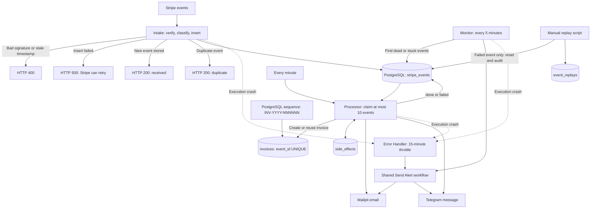

# Stripe Payment Automation with n8n

The goal: no payment is lost, none is invoiced twice, and every failure path is tested by breaking the system on purpose.

This portfolio project turns Stripe payment events into invoices and email/Telegram notifications using n8n and PostgreSQL. It separates durable webhook intake from asynchronous invoicing, delivery, and recovery. [PLAN.md](PLAN.md#plan) records M1–M4 complete and **35/35 e2e checks passed** for M4. The failure table shows the checks and deliberate outages behind that result, alongside the remaining test gaps.

## The problem

Payment events can arrive more than once, and invoicing must survive email outages, retries, and interrupted processing. This pipeline stores events before acknowledging them, creates one invoice per paid event, and tracks notification delivery separately. Failed or stuck events stay visible and can be replayed without deleting invoices or completed side-effect records. See the [invoice migration](migrations/004_invoices.sql), [M3](PLAN.md#m3-stripe-processor), and [M4](PLAN.md#m4-failure-visibility).

## Architecture

The diagram summarizes the contracts in the [milestone table](PLAN.md#plan), [M3](PLAN.md#m3-stripe-processor), and [M4](PLAN.md#m4-failure-visibility). Retry and alert delivery limits are listed below.

## How the pipeline works

1. **Accept and store.** Intake checks the Stripe signature, classifies the event, and performs an idempotent insert. Its response contract is 200/400/500, including a duplicate response. M2 records a Stripe CLI proof of the database-down 500 path. See the [milestone table](PLAN.md#plan).
2. **Claim work atomically.** Every minute, the Processor claims up to 10 eligible events, oldest first, using `FOR UPDATE SKIP LOCKED` in one SQL statement. Claiming sets `processing` and increments `attempts`. `done` and `ignored` events are excluded; failed events are eligible only below five attempts. See [M3 acceptance criteria 1–3](PLAN.md#acceptance-criteria).
3. **Create the invoice first.** Each valid paid event gets one invoice before notifications. PostgreSQL's `invoice_number_seq` generates sequential `INV-YYYY-NNNNNN` numbers; `event_id UNIQUE` and `ON CONFLICT` reuse the existing invoice on retries. The foreign key uses `ON DELETE RESTRICT`. Amounts stay in Stripe's smallest currency unit and are formatted with `Intl.NumberFormat('de-DE')`, including zero-decimal currencies such as JPY, whose amounts are not divided by 100. See [migration 004](migrations/004_invoices.sql), the [Processor](stripe-processor.sdk.ts#L62-L97), and [M4 replay proof](PLAN.md#proof-required-commands-and-output-shown-1).
4. **Deliver and record.** For each notification kind, the Processor checks `side_effects`, sends if no record exists, then inserts the record. The composite primary key is `(event_id, kind)`. Email and Telegram messages carry the invoice number and formatted amount. Success sets `done` and `processed_at`; failure records `failed` and a short `last_error`, without stopping the rest of the batch. See [M3 criteria 4–8](PLAN.md#acceptance-criteria) and the [Processor](stripe-processor.sdk.ts).
5. **Recover abandoned work.** Processing rows older than 10 minutes are released. Release and replay refresh `pending_since`, so an old receipt time does not cause a new pending episode to look stale. See [M3 criterion 9](PLAN.md#acceptance-criteria) and [M4 criterion 5](PLAN.md#acceptance-criteria-1).
6. **Expose failures.** The Monitor runs every five minutes and detects exhausted retries, stale pending events, stuck retryable failures, and stuck processing events. It records `alerted_at` after delivery. Execution crashes use a separate Error Handler with a 15-minute throttle per workflow/node and state outside PostgreSQL. Both use the shared alert sender. See [M4 criteria 1–8 and 12–15](PLAN.md#acceptance-criteria-1).
7. **Replay with an audit trail.** The PowerShell replay script accepts only failed events. One transaction resets processing state and adds an `event_replays` record with the operator's reason. Existing `side_effects` and `invoices` records remain intact; dry-run mode changes nothing. See [M4 criterion 9](PLAN.md#acceptance-criteria-1).

## Engineering decisions

- **Store first; return 500 on storage failure:** Stripe's retries recover unaccepted events instead of a premature 200 losing them. [M2](PLAN.md#plan)
- **`timingSafeEqual` plus a five-minute replay window:** compare signatures without a timing-sensitive equality check and reject signed requests older than five minutes. [Intake](stripe-intake.sdk.ts#L47-L62)
- **Database UNIQUE constraints:** enforce event and invoice uniqueness under concurrency rather than trusting a check-then-insert race. [Event schema](migrations/001_stripe_events.sql), [invoice schema](migrations/004_invoices.sql)
- **`ON DELETE RESTRICT` for financial records:** block deletion of a payment event while its invoice exists, preventing silent loss of financial history. [Migration 004](migrations/004_invoices.sql)
- **Single-meaning timestamps:** `pending_since` dates the current pending episode and `claimed_at` dates the processing claim, preventing false stale alerts after recovery. [M4 criteria 5 and 12](PLAN.md#acceptance-criteria-1)
- **Monitor separate from Processor:** a watchdog can report stalled processing even when the Processor itself is not running. [M4 criterion 4](PLAN.md#acceptance-criteria-1)

## Failure scenarios and evidence

[`scripts/e2e.ps1`](scripts/e2e.ps1) runs on every change as the definition of done. It checks invoice and delivery counts after first delivery, duplicate resend, and an actual Processor re-run, plus fake-signature rejection, replay safety, and migration lint. Deliberate service outages and seeded stuck events exercise the recovery paths documented in [PLAN.md](PLAN.md#m4-failure-visibility). The recorded M4 result is **35/35**; real Telegram 429/5xx and simultaneous alert-channel failure remain unproven.

| Scenario | Behavior | Evidence |
|---|---|---|
| Fake signature | HTTP 400; fake event is not stored. | [e2e section 7](scripts/e2e.ps1#L217-L233); [PLAN M2/M6](PLAN.md#plan). |
| Stale timestamp | HTTP 400 for requests older than five minutes. | [PLAN M6 criterion 2](PLAN.md#acceptance-criteria-2); [Intake age check](stripe-intake.sdk.ts#L47-L48). Separate stale-timestamp test remains open. |
| Duplicate event | HTTP 200 duplicate; one event row, one invoice, unchanged delivery counts. | [e2e section 6 and Assert-Counts](scripts/e2e.ps1#L168-L182); [PLAN M3 resend proof](PLAN.md#proof-required-commands-and-output-shown). |
| Processor re-run | Attempts increase, proving a real re-run; invoice, email side-effect, Telegram side-effect, and Mailpit counts stay at one. | [e2e section 6b](scripts/e2e.ps1#L184-L197); [PLAN M3 idempotency](PLAN.md#acceptance-criteria). |
| Unsafe migration | Preflight rejects SQL containing `ON DELETE CASCADE`. | [e2e preflight](scripts/e2e.ps1#L70-L71), [migration lint](scripts/lint-migrations.ps1); [PLAN e2e guard](PLAN.md#plan). |
| Database down during Intake | HTTP 500 lets Stripe retry; resend after recovery stores the event. | Stripe CLI outage proof recorded in [PLAN M2](PLAN.md#plan); [M6 recovery scenario](PLAN.md#acceptance-criteria-2). |
| Mailpit down during processing | Event fails with `last_error`; recovery and re-queue finish with one email. | [PLAN M3 outage proof](PLAN.md#proof-required-commands-and-output-shown). Mailpit restart clears the inbox; persistence is an open [M6 task](PLAN.md#acceptance-criteria-2). |
| Telegram returns 429/5xx | Intended behavior: backoff and at least three tries before marking the event failed. | [M3 criterion 6](PLAN.md#acceptance-criteria) defines the behavior; the [M3 status](PLAN.md#plan) explicitly says real 429/5xx backoff is **unproven**. |
| Two Processor runs overlap | Atomic claims prevent double processing: three pending events produce three emails, not six. | [PLAN M3 concurrency proof](PLAN.md#proof-required-commands-and-output-shown). |
| Ignored events exist | Processor leaves ignored events untouched. | [PLAN M3 ignored-events proof](PLAN.md#proof-required-commands-and-output-shown). |
| PostgreSQL down during Processor runs | One throttled crash alert over repeated failures; the next alert after the window reports the suppressed count. | [M4 proof list](PLAN.md#proof-required-commands-and-output-shown-1). |
| Event exhausts five attempts | One dead-event alert; later Monitor runs send none. After recovery, replay ends `done` with one email, one invoice, and one replay record. | [M4 dead-event and replay proofs](PLAN.md#proof-required-commands-and-output-shown-1). |
| Replay targets a done/ignored event or an invalid identifier | Refuse unchanged events; reject malformed identifiers before calling psql. | [M4 replay refusal and input-rejection proofs](PLAN.md#proof-required-commands-and-output-shown-1). |
| Pending event is stale | A freshly reset pending timestamp produces no alert; after 11 minutes, exactly one stale alert. | [M4 no-false-stale proof](PLAN.md#proof-required-commands-and-output-shown-1). |
| Retryable failed event is stuck | Old claim produces one alert; a fresh claim produces none. Processor pickup clears the alert marker. | [M4 stuck-failed proof](PLAN.md#proof-required-commands-and-output-shown-1). |
| Processing event is stuck | A 25-minute-old claim alerts once; a 12-minute control does not. Processor recovery completes both and clears their alert markers. | [M4 stuck-processing proof](PLAN.md#proof-required-commands-and-output-shown-1). |
| One alert channel fails | With Mailpit down, Telegram still receives the alert and `alerted_at` is set. | [M4 channel-independence proof](PLAN.md#proof-required-commands-and-output-shown-1); [known gaps](PLAN.md#known-gaps-carry-into-the-m6-failure-table) state that each single-channel failure was provoked. |
| Both alert channels fail | Intended Monitor behavior: leave `alerted_at` unset and retry. Error Handler can lose the alert and suppress repeats for 15 minutes. | [M4 known gaps](PLAN.md#known-gaps-carry-into-the-m6-failure-table): simultaneous failure is **unproven**, and the throttle-window loss is a documented gap. |
| n8n or WSL stops | Internal monitoring cannot alert. | [M4 known gaps](PLAN.md#known-gaps-carry-into-the-m6-failure-table); the external heartbeat is an open [M5 task](PLAN.md#plan). |

## Known limits

- **At-least-once delivery.** A crash after a send but before its side-effect insert can duplicate that notification. A Monitor crash after delivery but before setting `alerted_at` can duplicate an alert. The records reduce repeat sends during ordinary retries; they do not establish exactly-once delivery. See [M3 criterion 4](PLAN.md#acceptance-criteria) and [M4 criterion 6](PLAN.md#acceptance-criteria-1).
- **Invoice numbers are sequential, not gapless.** Rollbacks or conflicting inserts can consume sequence values; the sequence does not reset each year. See [migration 004](migrations/004_invoices.sql).
- **Incomplete failure evidence.** Real Telegram rate-limit/server-error backoff and simultaneous alert-channel failure have not been proven. Undeliverable Error Handler alerts consume the throttle window. See [M3 status](PLAN.md#plan) and [M4 known gaps](PLAN.md#known-gaps-carry-into-the-m6-failure-table).
- **Hardening remains open.** M5 still lists secret rotation, PostgreSQL backup, a live-mode checklist, a runbook, external monitoring, real alert addresses, and checks of workflow error-handler settings. This README makes no production-readiness claim. See [M5](PLAN.md#plan).
- **Recreation has an alerting risk.** Workflow `errorWorkflow` settings live in n8n rather than the SDK files. M5 calls for checking them so recreated workflows do not silently lose alerting. See [M5](PLAN.md#plan).
- **Local evidence and setup have limits.** Mailpit inbox persistence, a fresh-clone setup check, demo material, and a reset script remain M6 tasks. Bulk replay and a replay UI are out of scope for M4. See [M6](PLAN.md#m6-portfolio-packaging) and [M4 out of scope](PLAN.md#out-of-scope).

## Tech stack

| Technology | Role |
|---|---|
| n8n | Intake, scheduled Processor, Error Handler, Monitor, shared Send Alert workflow |
| PostgreSQL / SQL | Event storage, atomic claims with `FOR UPDATE SKIP LOCKED`, side-effect records, replay audit, invoice records |
| TypeScript SDK workflow files | Exported workflow sources in `.sdk.ts` files |
| Docker Compose | n8n, PostgreSQL, and Mailpit infrastructure (M1) |
| Mailpit / SMTP | Local email delivery and inspection |
| Telegram | Payment messages and operational alerts |
| Stripe / Stripe CLI | Webhook source and trigger/resend checks |
| PowerShell | Replay operations and `scripts/e2e.ps1` checks |

Sources: [M1–M4 status](PLAN.md#plan), [M3](PLAN.md#m3-stripe-processor), [M4](PLAN.md#m4-failure-visibility), and [invoice schema](migrations/004_invoices.sql).

## How it was built

- I used agentic engineering with Claude Code and Codex.
- I approved acceptance criteria before each build.
- I reviewed and corrected AI plans: CASCADE became RESTRICT, a missing invoice step was added, a fallback email address was rejected, and a false stale alert was found in review.
- I reviewed and ran database migrations myself.
- Guardrails: e2e as the definition of done, a [workflow drift hook](scripts/hooks/n8n-drift-reminder.mjs), [migration lint](scripts/lint-migrations.ps1), and secret scans.

## Reviewing the project

Start with [PLAN.md](PLAN.md) for acceptance criteria and recovery tests, then read the workflow sources: [Intake](stripe-intake.sdk.ts), [Processor](stripe-processor.sdk.ts), [Error Handler](stripe-error-handler.sdk.ts), [Monitor](stripe-monitor.sdk.ts), and [Send Alert](stripe-send-alert.sdk.ts). The [replay script](scripts/replay.ps1), [e2e script](scripts/e2e.ps1), and [migrations](migrations/) provide the operational context.

**Setup status:** clean-clone instructions and verification remain an [M6 task](PLAN.md#m6-portfolio-packaging). The 35/35 result above is the M4 run recorded in PLAN.md.

## Kurzfassung

Dieses Portfolio-Projekt verarbeitet Stripe-Zahlungen mit n8n und PostgreSQL zu Rechnungen sowie E-Mail- und Telegram-Benachrichtigungen. Pro bezahltem Ereignis entsteht genau eine Rechnung mit sequenzieller Nummer im Format `INV-YYYY-NNNNNN`; eine UNIQUE-Bedingung verhindert doppelte Rechnungen bei Wiederholungen. Beträge werden im Format `de-DE` ausgegeben, auch für Währungen ohne Nachkommastellen. Atomare Verarbeitung, Fehleralarme und protokollierte Replays sichern die Wiederaufnahme nach Störungen. PLAN.md dokumentiert M1–M4 als abgeschlossen und 35/35 e2e-Prüfungen. Bekannte Grenzen sind mögliche doppelte Benachrichtigungen nach einem Absturz, noch nicht belegte Telegram-Backoff-Fälle und fehlende externe Überwachung bei einem Ausfall von n8n oder WSL.
