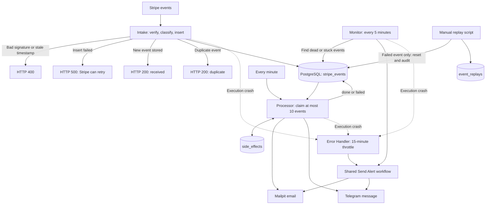

# Stripe Payment Automation with n8n

A portfolio project for software engineering and automation roles: a Stripe event pipeline that separates webhook intake from asynchronous processing, stores events in PostgreSQL, and delivers payment notifications through Mailpit and Telegram. The work focuses on failure handling: atomic claims, bounded retries, recorded side effects, operational alerts, and audited manual replay. [PLAN.md](PLAN.md#plan) records M1–M4 as complete, including a historical **35/35 e2e check** for M4; hardening and portfolio packaging remain open.

## The problem

Payment webhooks need a clear response even when downstream delivery fails. Doing email and messaging inside the webhook would couple acceptance of a payment event to those services. This pipeline stores the event first and gives slow work to a separate Processor. Failed or stuck events remain visible and can be retried or replayed without deliberately clearing the records of completed side effects. This separation and its acceptance criteria are documented in [M3](PLAN.md#m3-stripe-processor) and [M4](PLAN.md#m4-failure-visibility).

## Architecture

The diagram summarizes the contracts in the [milestone table](PLAN.md#plan), [M3](PLAN.md#m3-stripe-processor), and [M4](PLAN.md#m4-failure-visibility). Retry and alert delivery limits are listed below.

## How the pipeline works

1. **Accept and store.** Intake checks the Stripe signature, classifies the event, and performs an idempotent insert. Its response contract is 200/400/500, including a duplicate response. M2 records a Stripe CLI proof of the database-down 500 path. See the [milestone table](PLAN.md#plan).
2. **Claim work atomically.** Every minute, the Processor claims up to 10 eligible events, oldest first, using `FOR UPDATE SKIP LOCKED` in one SQL statement. Claiming sets `processing` and increments `attempts`. `done` and `ignored` events are excluded; failed events are eligible only below five attempts. See [M3 acceptance criteria 1–3](PLAN.md#acceptance-criteria).
3. **Deliver and record.** For each notification kind, the Processor checks `side_effects`, sends if no record exists, then inserts the record. The composite primary key is `(event_id, kind)`. Success sets `done` and `processed_at`; failure records `failed` and a short `last_error`, without stopping the rest of the batch. See [M3 criteria 4–8](PLAN.md#acceptance-criteria).
4. **Recover abandoned work.** Processing rows older than 10 minutes are released. Release and replay refresh `pending_since`, so an old receipt time does not cause a new pending episode to look stale. See [M3 criterion 9](PLAN.md#acceptance-criteria) and [M4 criterion 5](PLAN.md#acceptance-criteria-1).
5. **Expose failures.** The Monitor runs every five minutes and detects exhausted retries, stale pending events, stuck retryable failures, and stuck processing events. It records `alerted_at` after delivery. Execution crashes use a separate Error Handler with a 15-minute throttle per workflow/node and state outside PostgreSQL. Both use the shared alert sender. See [M4 criteria 1–8 and 12–15](PLAN.md#acceptance-criteria-1).
6. **Replay with an audit trail.** The PowerShell replay script accepts only failed events. One transaction resets processing state and adds an `event_replays` record with the operator's reason. Existing `side_effects` and `invoices` records remain intact; dry-run mode changes nothing. See [M4 criterion 9](PLAN.md#acceptance-criteria-1).

## Failure scenarios and evidence

Evidence here means what **PLAN.md records**, not a new test run. M2 and M3 have completion summaries but no pasted per-scenario transcripts. M4 explicitly records that its proofs ran and that e2e passed 35/35. A “required” proof is an acceptance target, not an observed result.

| Scenario | Behavior / result recorded in the plan | Proof and evidence status |
|---|---|---|
| Fake signature | Reject with HTTP 400. | [M6 criterion 2](PLAN.md#acceptance-criteria-2) requires this case; [M2](PLAN.md#plan) records signature checking complete, without an individual transcript. |
| Stale timestamp | Reject with HTTP 400. | [M6 criterion 2](PLAN.md#acceptance-criteria-2) specifies the case; no separate run result is recorded. |
| Duplicate event | HTTP 200 duplicate; one stored row. Resending a done event should leave notification counts unchanged. | [M2 completion summary](PLAN.md#plan), [M3 resend proof requirement](PLAN.md#proof-required-commands-and-output-shown), and [M6 criterion 2](PLAN.md#acceptance-criteria-2); milestone-level completion, no pasted counts. |
| Database down during Intake | Return HTTP 500; resending after recovery should store one row. | [M2](PLAN.md#plan) explicitly records the DB-down 500 as proven with Stripe CLI. The resend/one-row check is specified in [M6 criterion 2](PLAN.md#acceptance-criteria-2), without separate output. |
| Mailpit down during processing | Event fails with `last_error`; after recovery and re-queue it should finish with one email. | [M3 required proof](PLAN.md#proof-required-commands-and-output-shown); M3 is marked DONE, but per-scenario output is absent. [M6 criterion 7](PLAN.md#acceptance-criteria-2) notes that restarting Mailpit wiped inbox evidence. |
| Telegram returns 429/5xx | Intended behavior: backoff and at least three tries before marking the event failed. | [M3 criterion 6](PLAN.md#acceptance-criteria) defines the behavior; the [M3 status](PLAN.md#plan) explicitly says real 429/5xx backoff is **unproven**. |
| Two Processor runs overlap | Atomic claims should prevent double processing; required check: three pending events produce three emails, not six. | [M3 criteria 2 and required proof](PLAN.md#m3-stripe-processor); milestone marked DONE, no individual concurrency transcript. |
| Ignored events exist | Processor leaves ignored events untouched. | [M3 criteria 3 and required proof](PLAN.md#m3-stripe-processor); milestone marked DONE, no individual result output. |
| PostgreSQL down during Processor runs | One throttled crash alert over repeated failures; the next alert after the window reports the suppressed count. | [M4 proof list](PLAN.md#proof-required-commands-and-output-shown-1), covered by the [M4 “proofs run” summary](PLAN.md#plan). |
| Event exhausts five attempts | One dead-event alert; later Monitor runs send none. After recovery, replay ends `done` with one email, one invoice, and one replay record. | [M4 dead-event and replay proofs](PLAN.md#proof-required-commands-and-output-shown-1), recorded as run in the [M4 summary](PLAN.md#plan). |
| Replay targets a done/ignored event or an invalid identifier | Refuse unchanged events; reject malformed identifiers before calling psql. | [M4 replay refusal and input-rejection proofs](PLAN.md#proof-required-commands-and-output-shown-1), recorded as run in the [M4 summary](PLAN.md#plan). |
| Pending event is stale | A freshly reset pending timestamp produces no alert; after 11 minutes, exactly one stale alert. | [M4 no-false-stale proof](PLAN.md#proof-required-commands-and-output-shown-1), recorded as run in the [M4 summary](PLAN.md#plan). |
| Retryable failed event is stuck | Old claim produces one alert; a fresh claim produces none. Processor pickup clears the alert marker. | [M4 stuck-failed proof](PLAN.md#proof-required-commands-and-output-shown-1), recorded as run in the [M4 summary](PLAN.md#plan). |
| Processing event is stuck | A 25-minute-old claim alerts once; a 12-minute control does not. Processor recovery completes both and clears their alert markers. | [M4 stuck-processing proof](PLAN.md#proof-required-commands-and-output-shown-1), recorded as run in the [M4 summary](PLAN.md#plan). |
| One alert channel fails | With Mailpit down, Telegram still receives the alert and `alerted_at` is set. | [M4 channel-independence proof](PLAN.md#proof-required-commands-and-output-shown-1); [known gaps](PLAN.md#known-gaps-carry-into-the-m6-failure-table) state that each single-channel failure was provoked. |
| Both alert channels fail | Intended Monitor behavior: leave `alerted_at` unset and retry. Error Handler can lose the alert and suppress repeats for 15 minutes. | [M4 known gaps](PLAN.md#known-gaps-carry-into-the-m6-failure-table): simultaneous failure is **unproven**, and the throttle-window loss is a documented gap. |
| n8n or WSL stops | Internal monitoring cannot alert. | [M4 known gaps](PLAN.md#known-gaps-carry-into-the-m6-failure-table); the external heartbeat is an open [M5 task](PLAN.md#plan). |

## Known limits

- **At-least-once delivery.** A crash after a send but before its side-effect insert can duplicate that notification. A Monitor crash after delivery but before setting `alerted_at` can duplicate an alert. The records reduce repeat sends during ordinary retries; they do not establish exactly-once delivery. See [M3 criterion 4](PLAN.md#acceptance-criteria) and [M4 criterion 6](PLAN.md#acceptance-criteria-1).
- **Incomplete failure evidence.** Real Telegram rate-limit/server-error backoff and simultaneous alert-channel failure have not been proven. Undeliverable Error Handler alerts consume the throttle window. See [M3 status](PLAN.md#plan) and [M4 known gaps](PLAN.md#known-gaps-carry-into-the-m6-failure-table).
- **Hardening remains open.** M5 still lists secret rotation, PostgreSQL backup, a live-mode checklist, a runbook, external monitoring, real alert addresses, and checks of workflow error-handler settings. This README makes no production-readiness claim. See [M5](PLAN.md#plan).
- **Recreation has an alerting risk.** Workflow `errorWorkflow` settings live in n8n rather than the SDK files. M5 calls for checking them so recreated workflows do not silently lose alerting. See [M5](PLAN.md#plan).
- **Local evidence and setup have limits.** Mailpit inbox persistence, a fresh-clone setup check, demo material, and a reset script remain M6 tasks. Bulk replay and a replay UI are out of scope for M4. See [M6](PLAN.md#m6-portfolio-packaging) and [M4 out of scope](PLAN.md#out-of-scope).

## Tech stack

| Technology | Role supported by PLAN.md |
|---|---|
| n8n | Intake, scheduled Processor, Error Handler, Monitor, shared Send Alert workflow |
| PostgreSQL / SQL | Event storage, atomic claims with `FOR UPDATE SKIP LOCKED`, side-effect records, replay audit, invoice records |
| TypeScript SDK workflow files | Exported workflow sources in `.sdk.ts` files |
| Docker Compose | n8n, PostgreSQL, and Mailpit infrastructure (M1) |
| Mailpit / SMTP | Local email delivery and inspection |
| Telegram | Payment messages and operational alerts |
| Stripe / Stripe CLI | Webhook source and trigger/resend checks |
| PowerShell | Replay operations and `scripts/e2e.ps1` checks |

Sources: [M1–M4 status](PLAN.md#plan), [M3](PLAN.md#m3-stripe-processor), and [M4](PLAN.md#m4-failure-visibility). No LLM step is required by M3; the plan does not establish an AI component.

## Reviewing the project

Start with [PLAN.md](PLAN.md) for acceptance criteria and evidence boundaries, then read the workflow sources: [Intake](stripe-intake.sdk.ts), [Processor](stripe-processor.sdk.ts), [Error Handler](stripe-error-handler.sdk.ts), [Monitor](stripe-monitor.sdk.ts), and [Send Alert](stripe-send-alert.sdk.ts). The [replay script](scripts/replay.ps1), [e2e script](scripts/e2e.ps1), and [migrations](migrations/) provide the operational context described by the plan.

**Setup status:** a working clean-clone setup is not established by PLAN.md. M1 records completed infrastructure, but M6 still requires setup instructions and a fresh-clone check. No fresh-clone verification or new runtime test was performed for this documentation draft. The 35/35 result above is the historical M4 result recorded in PLAN.md.

## Kurzfassung

Dieses Portfolio-Projekt zeigt eine Stripe-Ereignispipeline mit n8n und PostgreSQL. Der Webhook speichert Ereignisse; ein separater Processor übernimmt E-Mail- und Telegram-Benachrichtigungen. Atomare Datenbankzugriffe, begrenzte Wiederholungen, Fehleralarme und ein protokollierter Replay-Prozess machen die Fehlerbehandlung nachvollziehbar. PLAN.md dokumentiert M1–M4 als abgeschlossen und einen e2e-Lauf mit 35/35 Prüfungen. Bekannte Grenzen sind mögliche doppelte Zustellungen nach einem Absturz, noch nicht belegte Telegram-Backoff-Fälle und fehlende externe Überwachung bei einem Ausfall von n8n oder WSL. Härtung und Prüfung der Einrichtung aus einem frischen Clone stehen noch aus.
